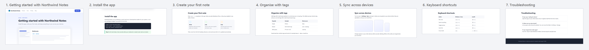
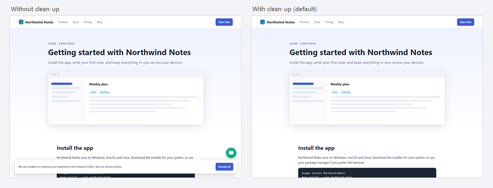
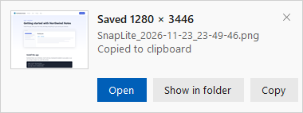
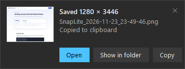
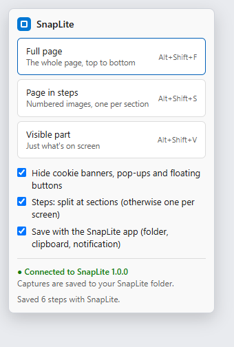
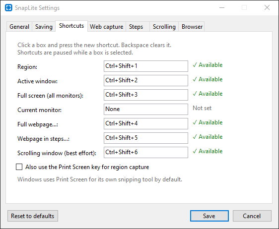
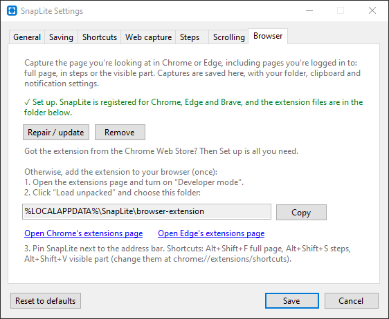

# SnapLite

A small Windows screenshot tool that lives in the tray. It uses no CPU while idle, about 14 MB of
memory, and is ready in about 0.1 s.

**[⬇ Download the latest release](https://github.com/claeslanng/SnapLite/releases/latest)**: one
2.7 MB exe for Windows 10/11 (64-bit). It needs the free .NET 10 Desktop Runtime; Windows offers
to install it if it's missing. Or get the standalone zip (46 MB), which needs nothing.

## Installing

Open the downloaded exe. SnapLite offers to install itself:

- **Install** copies it to `%LOCALAPPDATA%\Programs\SnapLite` and adds it to the Start menu and to
  **Settings › Apps** (where you can uninstall it). It can also start with Windows. No admin rights
  are needed, and everything stays in your own user profile.
- **Just run it** runs it from where it is, and you won't be asked again. You can still install
  later from Settings → General.

Opening a newer download offers to update the installed copy, keeping your settings. Uninstalling
removes the program, its shortcut, autostart and browser registration, and optionally your
settings. Your screenshots are always kept.

Windows SmartScreen may warn the first time ("Windows protected your PC") because the exe isn't
code-signed: click **More info → Run anyway**.

- **Region, window, monitor or full screen**: saved to a file and copied to the clipboard.
- **Full webpage**: renders a URL in a hidden browser (WebView2) and captures the whole page,
  with cookie banners and floating bars cleaned up.
- **Webpage in steps**: the same page split into numbered images at its sections, plus a
  `steps.md` index. Good for tutorials and documentation.
- **Scrolling window (best effort)**: scrolls any window (browser, editor, chat…) and stitches
  one tall image. This works on pages you're logged in to.
- **Browser extension** for Chrome, Edge and Brave: full page, steps or the visible part of the tab
  you're on, logged in or not, saved through SnapLite (or downloaded if the app isn't there).
- A notification after each capture with **Open**, **Show in folder** and **Copy**.
- Configurable global shortcuts with conflict detection, a JSON settings file, start with Windows,
  and a single instance.

## Screenshots

**Webpage in steps.** One page becomes numbered images, each starting at a section heading, with a
`steps.md` index that lists every image under its heading:



**Clean-up.** Cookie banners, pop-ups and floating chat buttons are hidden before the capture, and
sticky headers appear only once:



<table>
<tr>
<td width="50%" valign="top"><b>After every capture</b>: open it, show it in its folder, or copy it again.
Follows the Windows light/dark setting and never takes focus.<br><br>
<br>
</td>
<td width="50%" valign="top"><b>Browser extension</b>: full page, steps or the visible part of the tab
you're on, saved through the app.<br><br>
</td>
</tr>
</table>

**Settings.** Shortcuts are checked as you type them, and ones another app already uses are flagged.
Setting up the browser extension takes one click here:

<p>


</p>

The demo page in these pictures is [docs/demo/demo-article.html](docs/demo/demo-article.html), a
made-up product page. `docs/make-screenshots.ps1` regenerates all of them with SnapLite itself.

## Requirements

- Windows 10 (version 2004 or later) or Windows 11, 64-bit.
- For the small exe: the [.NET 10 Desktop Runtime (x64)](https://dotnet.microsoft.com/download/dotnet/10.0).
  The self-contained exe doesn't need it.
- For web capture: the Microsoft Edge WebView2 Runtime. It's preinstalled on Windows 11 and on
  up-to-date Windows 10; SnapLite tells you if it's missing.

## Shortcuts (defaults)

| Shortcut | Capture |
|---|---|
| Ctrl+Shift+1 | Region (drag a rectangle; arrow keys nudge, Esc cancels) |
| Ctrl+Shift+2 | Active window |
| Ctrl+Shift+3 | Full screen (all monitors) |
| Ctrl+Shift+4 | Full webpage… |
| Ctrl+Shift+5 | Webpage in steps… |
| Ctrl+Shift+6 | Scrolling window (the window under the mouse) |
| — | Current monitor (set one in Settings) |

All shortcuts can be changed under **Settings → Shortcuts**. A shortcut another program already
uses is flagged before you save. You can also let the bare **Print Screen** key start a region
capture. Left-clicking the tray icon starts a region capture by default; right-click for the
menu (captures, open folder, settings, pause shortcuts, exit).

## Where things go

| What | Where |
|---|---|
| Program (when installed) | `%LOCALAPPDATA%\Programs\SnapLite\SnapLite.exe` |
| Captures | `Pictures\SnapLite` (change under Settings → Saving) |
| Steps | a subfolder per page: `Title_2026-11-23_10-15-00\Title_01.png …` + `steps.md` |
| Settings | `%APPDATA%\SnapLite\settings.json` (a broken file is kept as `settings.bad.json`) |
| Error log | `%LOCALAPPDATA%\SnapLite\snaplite.log` (only written when something goes wrong) |
| Last scroll capture | `%LOCALAPPDATA%\SnapLite\last-scroll-capture.log` plus `scroll-sample-*.png` / `scroll-fail-*.png` |
| Browser extension | `%LOCALAPPDATA%\SnapLite\browser-extension` (written by Settings → Browser → Set up) |

If the save folder can't be used (for example an unplugged drive), the capture is saved to
`Pictures\SnapLite` instead and the notification says so. Nothing ever leaves your PC.

## Tips

- **Pages that need a login:** the desktop full-webpage and steps captures use a hidden browser that
  isn't logged in to anything. For those pages, use the **browser extension** (see below) or
  **scrolling window** (Ctrl+Shift+6).
- **Scrolling window:** point at the window, press the shortcut and keep your hands off until the
  banner disappears. Moving the mouse or pressing Esc stops it, and you keep what was captured so
  far. Sticky headers, footers and side panels are detected and kept out of the image. It stops at
  the bottom of the page, after 2 minutes, or at the height limit (20,000 px; Settings → Scrolling).
- **Webpage options:** pick the viewport width (1280, 1440, 1920 or 390 for mobile view) and the
  clean-up options in the dialog; SnapLite remembers your last choice.

## Browser extension

The extension captures the tab you're looking at in your own browser, so pages you're logged in to
work too. It scrolls the page screen by screen, stitches the screenshots, and puts the page back the
way it was (scroll position, hidden banners, paused videos). Then it hands the image to SnapLite,
which saves it with your folder, clipboard and notification settings. Steps are split at the page's
sections by the same code the desktop app uses.

**Set up (once):**

1. In SnapLite: **Settings → Browser → Set up**. This writes the extension to
   `%LOCALAPPDATA%\SnapLite\browser-extension` and registers SnapLite with Chrome, Edge and Brave
   (per user; no admin rights needed).
2. In the browser, open the extensions page (`chrome://extensions` or `edge://extensions`), turn on
   **Developer mode**, click **Load unpacked** and choose that folder.
3. Pin SnapLite next to the address bar.

| Shortcut (browser) | Capture |
|---|---|
| Alt+Shift+F | Full page |
| Alt+Shift+S | Page in steps |
| Alt+Shift+V | Visible part |

You can change these at `chrome://extensions/shortcuts`. The toolbar icon shows progress (percent,
then ✓). If SnapLite isn't running, the extension starts it. If SnapLite isn't installed, images are
downloaded to `Downloads\SnapLite` instead. Steps are then cut one per screen, because splitting at
sections needs the app.

The extension only asks for `activeTab`, so it can only see a tab when you click its icon or press
one of its shortcuts. It has no access to your other tabs or your browsing history.

Everything needed to publish it in the Chrome Web Store or Edge Add-ons (package, listing texts,
images, checklist) is in [docs/store](docs/store/README.md). `publish.ps1` builds the upload
package, `publish\SnapLite-extension-<version>-store.zip`.

## Command line

```powershell
SnapLite.exe --capture-url https://example.com --out page.png [--width 1440] [--no-cleanup]
SnapLite.exe --capture-url https://example.com --out .\folder --steps smart|simple
```

These commands run without the tray app and work while it's running. The exit code is 0 on success.

## Building

You need the .NET 10 SDK.

```powershell
dotnet build SnapLite.sln -c Release
dotnet test tests/SnapLite.Tests
node --test tests/extension
& .\src\SnapLite\bin\Release\net10.0-windows\SnapLite.exe
```

The extension's tests need Node.js; the extension itself is plain JavaScript with no build step.

To regenerate the screenshots in `docs/` after a Release build, run `docs\make-screenshots.ps1`.

## Privacy

SnapLite collects nothing and sends nothing anywhere; see the [privacy policy](docs/privacy.md).

## License

[MIT](LICENSE)

### Publishing

```powershell
.\publish.ps1
```

`publish.ps1` runs the tests, then makes two single-file builds in `publish\`:

| Build | Size | Needs | Startup | Idle memory (private) |
|---|---|---|---|---|
| `framework-dependent\SnapLite.exe` | 2.7 MB | .NET 10 Desktop Runtime | ~0.1 s | ~14 MB |
| `self-contained\SnapLite.exe` | 118 MB | nothing | ~0.8 s | ~18 MB |

`publish.ps1` also zips the self-contained exe into `publish\SnapLite-win-x64-standalone.zip`
(about 46 MB), which is the version to upload for download. The self-contained exe isn't compressed on purpose. Compression makes it 51 MB, but then every
run unpacks the runtime into memory (about 79 MB instead of 18 MB). WinForms apps can't be
trimmed. To build only one of them: `.\publish.ps1 -Only FrameworkDependent`.

For scripts: `SnapLite.exe --install [--startup] [--no-launch]` installs without asking, and
`SnapLite.exe --uninstall --quiet [--remove-data]` uninstalls without asking. Run as a portable
exe, "Start with Windows" (Settings → General) follows the exe if you move it.

## Performance

Measured on the framework-dependent build, Windows 10, 1920×1080:

- **Idle CPU:** 0 ms of CPU time over 60 s. There are no timers or polling; everything runs on
  Windows messages (hotkeys, tray clicks).
- **Idle memory:** about 14.6 MB working set and 13.6 MB private bytes. Memory is returned to
  Windows after every capture and after closing the settings window.
- **Startup:** about 0.1 s until the shortcuts work (median of 5 runs: 94–154 ms). The tray menu is built
  just after startup, when the app first goes idle.

## How it's built

```
src/SnapLite         the app: Tray, Hotkeys, Capture, ScrollCapture, WebCapture, Bridge, Settings, Output, Interop
src/SnapLite.Core    testable algorithms: step splitting, scroll stitching, frame analysis, native messaging
tests/SnapLite.Tests xUnit tests (step splitting, overlap detection / stitching, bridge)
tests/extension      Node tests for the extension's stitching maths
extension            the browser extension (Manifest V3, plain JavaScript; embedded in the exe)
shared-scripts       page scripts used by both the desktop web capture and the extension
```

- C# / .NET 10 WinForms, PerMonitorV2 DPI awareness, Win32 through `LibraryImport`.
- NuGet packages: only `Microsoft.Web.WebView2` (the app) and xUnit (tests).
- Global shortcuts use `RegisterHotKey` on a message-only window. A named mutex keeps it to one
  instance; starting it again opens Settings.
- **Web capture:** WebView2 in an off-screen window, driven through the DevTools protocol. The
  page is scrolled to trigger lazy loading, the network is waited on, then screenshots are taken
  one viewport at a time and stitched.
- **Scroll capture:** sends mouse-wheel input. Each new screenshot is lined up against the
  previous one by hashing strips of each row and voting on the offset. Rows and columns that
  don't move with the page (sticky bars, side panels, see-through nav bars, the scrollbar) are
  found and left out.

- **Browser bridge:** the extension starts `SnapLite.exe chrome-extension://…/` as its native
  messaging host. It sends the PNG in chunks of about 1 MB; the host writes it to
  `%LOCALAPPDATA%\SnapLite\incoming` and passes it to the running tray app over a named pipe that only
  your Windows user can open. The tray app only accepts files from that folder, and deletes them
  after saving. The extension's ID is fixed by a public key in its manifest, and only that ID may
  start the host.

## Known limitations

- Scroll capture is best effort. The window must stay in front. Content that animates on its own
  (videos, carousels) can make it stop early; you then get what was captured so far.
- Animated mock-ups that only appear through JavaScript (for example the code.visualstudio.com
  carousel) can come out blank in full-webpage capture.
- The full-webpage capture's hidden browser isn't logged in to sites; use the browser extension
  for those pages.
- The extension must be loaded with "Load unpacked" (it isn't in the Chrome Web Store). Chrome may
  show a "developer mode extensions" reminder at startup. The tab has to stay in front while it
  captures, and Chrome limits it to two screenshots a second (about 0.5 s per screen).
